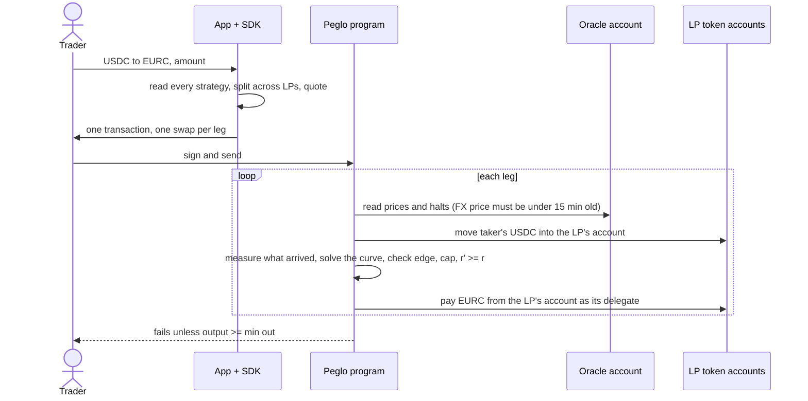
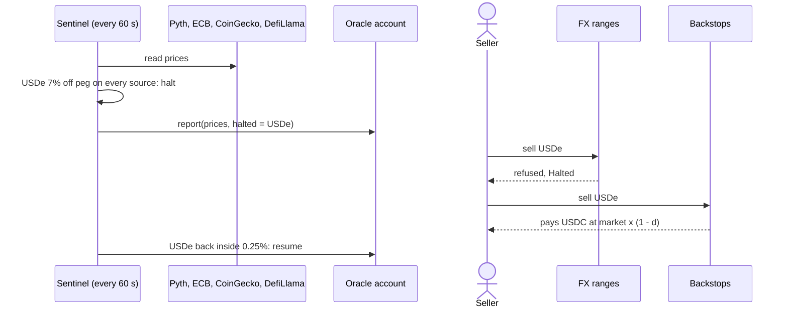
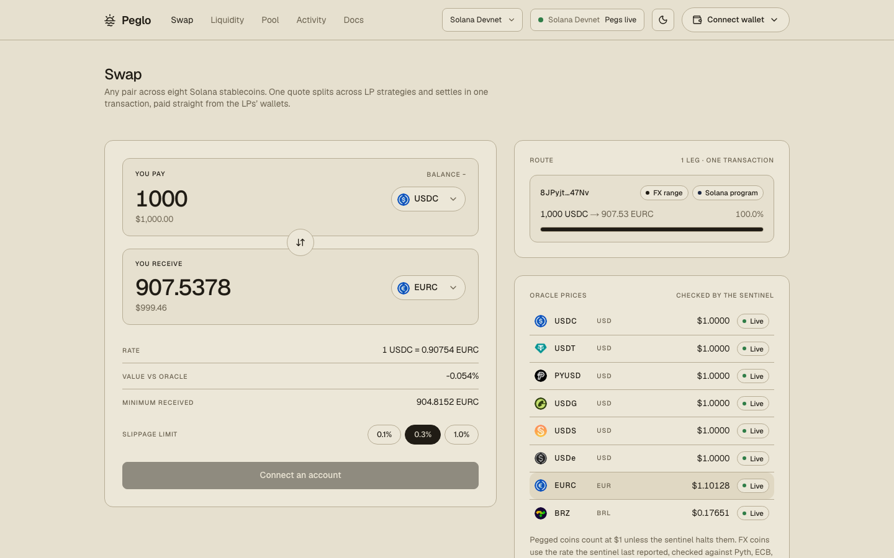
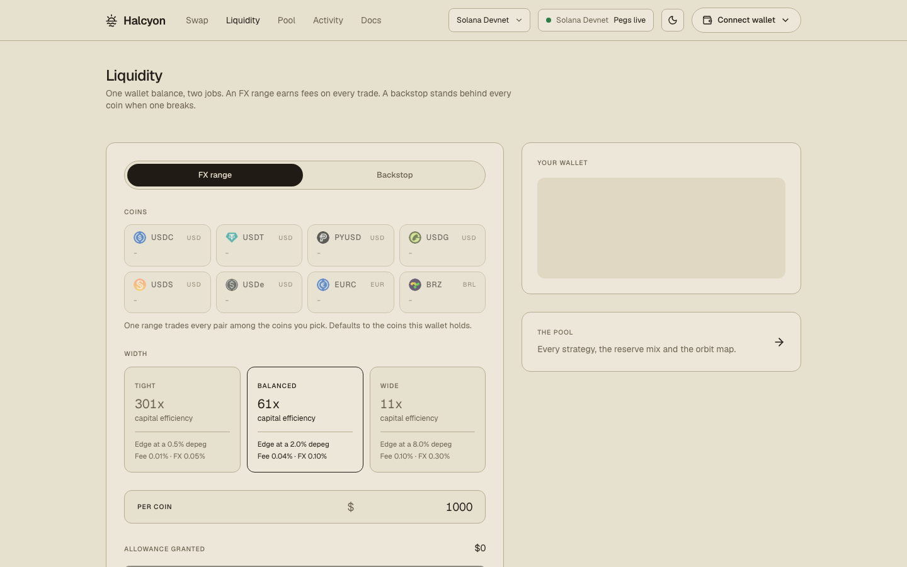
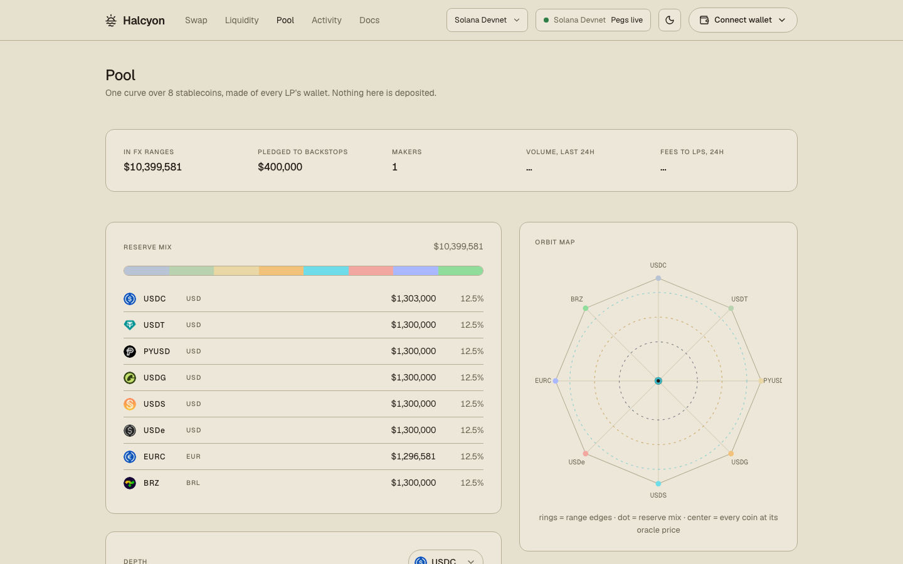
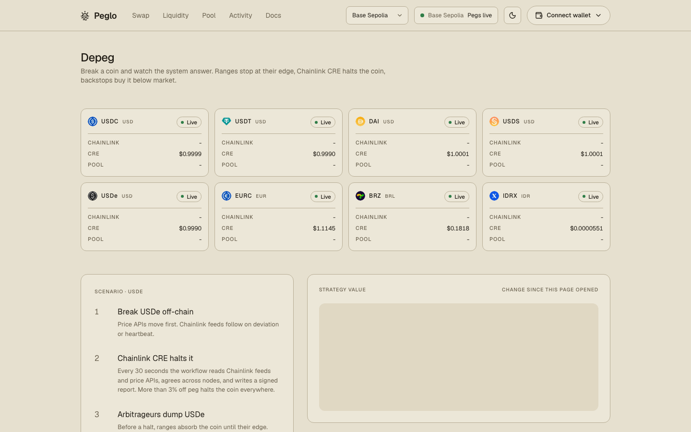
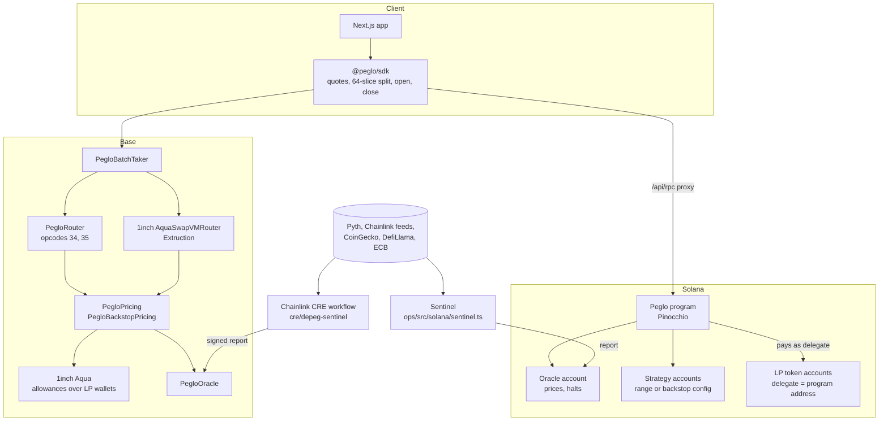
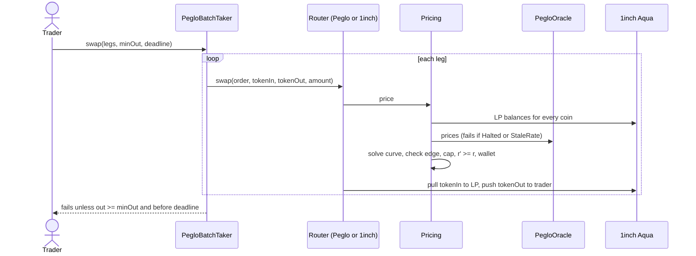
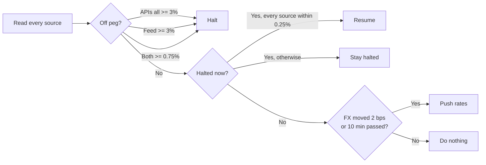
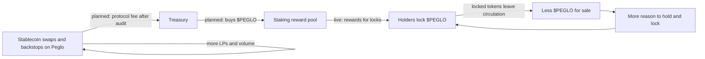

# Peglo

**Liquidity that never leaves.** Stablecoin FX markets and depeg backstops on **Solana** and on **1inch Aqua** (Base). One wallet balance makes markets across 8 stablecoins and stands behind every coin when one breaks. The coins never leave the wallet.

[App](https://peglo.fun) · [Litepaper](https://peglo.fun/litepaper) · [Pitch deck](https://peglo.fun/deck) · [Solana mainnet program](https://solscan.io/account/9yndJ2CVGSWr58nXNVS8rgkYFiiXghkchicSK5KjhABw) · [Addresses](#8-addresses-and-revenue) · [Run locally](#17-run-locally) · [Tests](#18-verify-and-tests)


> The programs and contracts have not been audited. Test with small amounts.

## Contents

1. [What this is and who it is for](#1-what-this-is-and-who-it-is-for)
2. [Story and inspiration](#2-story-and-inspiration)
3. [Problem](#3-problem)
4. [Solution](#4-solution)
5. [How it works](#5-how-it-works)
6. [Target users](#6-target-users)
7. [Features](#7-features)
8. [Addresses and revenue](#8-addresses-and-revenue)
9. [Sponsor and partner integrations](#9-sponsor-and-partner-integrations)
10. [Tech stack](#10-tech-stack)
11. [Architecture](#11-architecture)
12. [Competitors](#12-competitors)
13. [Go to market](#13-go-to-market)
14. [Business model](#14-business-model)
15. [Roadmap](#15-roadmap)
16. [Team](#16-team)
17. [Run locally](#17-run-locally)
18. [Verify and tests](#18-verify-and-tests)
19. [Repo layout](#19-repo-layout)
20. [Security notes](#20-security-notes)
21. [$PEGLO token](#21-peglo-token)
22. [Token flywheel](#22-token-flywheel)
23. [License](#23-license)

## 1. What this is and who it is for

Peglo is a stablecoin market where liquidity providers keep their coins in their own wallets. One balance does two jobs at the same time:

| | FX range | Peg backstop |
|---|---|---|
| When it trades | Every day | Only after the oracle halts a broken coin |
| What it does | Prices up to 8 stablecoins on one curve: dollar coins at $1, EURC and BRZ at live FX rates | Buys the broken coin below market, pays in healthy coins, never above face value |
| Earns | Swap fees, 1 to 10 bps on dollar pairs, 5 to 30 bps on FX pairs | The discount, 1% to 25% depending on the preset |

It is for anyone holding idle stablecoins who wants them to earn without depositing them anywhere: treasuries, DAOs, funds, market makers and individual holders. It is also for traders who want the cheapest swap between stablecoins, including across currencies (USD to EUR, USD to BRL), and for anyone who needs a buyer when a stablecoin depegs.

## 2. Story and inspiration

Peglo started as a hackathon project on 1inch Aqua and Chainlink CRE. Aqua introduced a new idea: a strategy can be an allowance over a wallet instead of a deposit into a pool, so one balance can back many strategies at once. That raised a question nobody had answered: if capital no longer has to pick one job, can the same dollars run an everyday FX market and also be the buyer of last resort in a depeg?

Every past depeg (UST, USDC in March 2023, USDe wobbles) followed the same script: pools fill with the broken coin, LPs take the loss, and liquidity disappears exactly when holders need it. A backstop that is funded by idle balances and paid for its risk fixes that, but only if keeping it costs nothing on calm days. Shared liquidity makes that possible.

After the hackathon the same design was ported to Solana as a native program, where stablecoin volume is high, fees are low, and token delegates give the same "coins stay in the wallet" property as Aqua. Solana mainnet went live on 2026-11-15. The EVM version on Base remains live alongside it.

## 3. Problem

Hundreds of billions of dollars of stablecoins sit in wallets and treasuries earning nothing. To earn swap fees today you lock them in a pool, and a pool has two weaknesses:

- **Your coins leave your wallet.** Capital in one pool cannot do anything else, so a treasury that wants to make markets has to choose one job for every dollar.
- **A depeg lands on the LPs.** When one coin breaks, arbitrageurs dump it into the pool and take the healthy coins out. LPs end up holding the broken coin at the worst price, and the market loses its liquidity when it needs it most.

Non-dollar stablecoins (EURC, BRZ) have a third problem: they trade in thin pairs against USDC only, at wide spreads, because no venue prices them on the same curve as the dollar coins.

## 4. Solution

Peglo gives one wallet balance two jobs at once, without moving a coin out of the wallet.

- **FX ranges** price up to 8 stablecoins on one concentrated sphere curve. Dollar coins trade at $1, EURC and BRZ at live FX rates. Tight ranges quote each real dollar like $301 of liquidity.
- **Peg backstops** stay dormant until the oracle halts a coin. Then they buy that coin at the market price minus a discount the LP chose in advance, pay in healthy coins, and never pay above face value.
- **The same balance backs both.** On Solana a strategy approves the Peglo program as an SPL token delegate; on Base it is an Aqua allowance. Nothing moves until a trade fills, and then the taker is paid straight from the LP's wallet.

The result: **a buyer of last resort for every stablecoin, funded by idle wallet balances.** On a normal day it is the cheapest place to swap one stablecoin for another, including across currencies. On a bad day it is the only place still buying.

## 5. How it works

### The curve

FX ranges use the sphere AMM from [Paradigm's research paper on AMMs for many stablecoins](https://www.paradigm.xyz/2025/06/orbital). Uniswap prices two tokens on a hyperbola. A sphere prices n tokens at once:

$$
x \cdot y = k \quad\longrightarrow\quad \sum_{k=1}^{n} (r - v_k)^2 = r^2
$$

| Piece | What it means here |
|---|---|
| **Virtual balance** | $v_k = x_k \rho_k + m$. $x_k$ is the LP's real balance of coin $k$, $\rho_k$ its USD price from the oracle, $m$ a virtual floor under every coin |
| **Peg point** | All $v_k$ equal at $r(1 - 1/\sqrt{n})$, where every coin trades at its oracle price. The curve only bends as the basket drifts |
| **Price** | $p_{ij} = \frac{r - v_i}{r - v_j} \cdot \frac{\rho_i}{\rho_j}$. With $\rho$ from the oracle, EURC and BRZ trade on the same curve as the dollar coins at live FX rates |
| **Concentration** | The floor $m$ makes a range tight. Tight sets $m = 300 \times$ the deposit, so each real dollar quotes like $301. Balanced is 61x, Wide 11x |
| **Range edge** | A swap that would push $\sum v_k$ past the range's edge is refused. The range stops buying a falling coin instead of buying more of it |
| **Exposure cap** | No coin may grow past $2/n$ of the range by default, so one coin cannot take over an LP's balance |
| **LP check** | The radius $r$ is re-derived from live balances on every swap, and the swap fails unless $r' \ge r$. A trade can never make the LP poorer |

Swaps are closed form: a square root for the radius and one for the output, with no iterative solver and no tick crossing. Fees stay in the LP's wallet and compound into the radius.

| Preset | Capital efficiency | Edge | Fee, dollar pairs | Fee, FX pairs |
|---|---|---|---|---|
| Tight | 301x | 0.5% | 1 bp | 5 bps |
| Balanced | 61x | 2% | 4 bps | 10 bps |
| Wide | 11x | 8% | 10 bps | 30 bps |

### The backstop

A backstop asks the oracle for the coin's depeg price, and the oracle refuses with `NotDepegged` until the coin is halted. After a halt:

$$
\text{out} = a \cdot \min(\text{market}, 1) \cdot (1 - d) \,/\, p_{\text{out}}, \qquad d = d_0 + (d_1 - d_0)\,\frac{A + a/2}{C}
$$

$a$ is the amount sold, $A$ what the backstop already absorbed, $C$ its cap per coin. The discount grows from $d_0$ to $d_1$ as the cap fills, so the first seller gets the best price and one trade can never drain a backstop. It pays only in coins that are not halted and never above face value.

| Preset | Discount |
|---|---|
| Light | 1% to 5% |
| Standard | 2% to 10% |
| Deep | 5% to 25% |

At the same moment every FX range refuses the halted coin as input. Healthy pairs keep trading. The broken coin can only be sold to backstops, at a price their LPs chose in advance.

### The depeg policy

The same rules run in the Chainlink CRE workflow on Base and in the sentinel on Solana:

| Rule | Threshold |
|---|---|
| Halt on the offchain APIs | 3% off peg, and every configured API must agree |
| Halt on the market feed | 3% off peg, the feed alone is enough |
| Halt on both | Both sources past 0.75% |
| Resume | Every source that answered is back inside 0.25%, so one lagging API cannot lift a halt |
| FX rate push | On a 2 bp move, or every 10 minutes |

### A swap on Solana



### A depeg on Solana



### Custody

- **Opening a strategy** approves a per-LP program address as SPL delegate (Solana) or ships an Aqua allowance (Base). Nothing transfers. The coins stay in the LP's wallet and stay spendable.
- **A fill** moves the taker's coin into the LP's wallet and pays the taker from it, in one instruction.
- **Shared liquidity.** A range and a backstop can both cover the same $100k of USDC. Whichever fills first uses the coins; the other sees the lower balance on its next quote.
- **Wallet shortfall.** If the LP spent the coins elsewhere, that leg fails and the SDK skips the LP on the next quote.
- **Closing** ends the strategy and refunds its rent. The SDK revokes the delegate once no strategy uses that coin. There is no withdrawal, because nothing was deposited.

## 6. Target users

| Who | What they get |
|---|---|
| Treasuries and DAOs with idle stablecoins | Swap fees and backstop premiums on coins that never leave their multisig or wallet |
| Stablecoin issuers (PYUSD, USDG, EURC, BRZ) | Deep pairs against every other stablecoin on one curve, and a standing buyer if their coin wobbles |
| Traders and payment apps | The cheapest USD to USD and USD to EUR or BRL swaps, one transaction across every LP |
| Market makers | Concentrated multi-coin ranges with no deposit and no LP token |
| Holders in a depeg | A place to sell the broken coin at a known discount instead of an empty pool |

## 7. Features

- **No deposits.** Coins never leave the LP's wallet. No LP token, no withdrawal.
- **8 coins, 56 directions per strategy.** Solana: USDC, USDT, PYUSD, USDG, USDS, USDe, EURC, BRZ (PYUSD and USDG are Token-2022). Base: USDC, USDT, DAI, USDS, USDe, EURC, BRZ, IDRX.
- **FX in the same book.** EURC and BRZ trade against the dollar coins at live rates.
- **Depeg backstops.** Dormant until a halt, then buy at a discount that grows with size, capped per coin.
- **Low cost.** Measured live on Base Sepolia: $10,000 USDC to DAI costs 1.12 bps, $100,000 costs 2.21 bps, fees included. On Solana a swap costs the normal 0.000005 SOL fee and about 50,000 compute units per leg.
- **Smart routing.** The SDK splits a trade into 64 slices across every LP and strategy, and the quote equals the received amount exactly.
- **One app, four networks.** Solana mainnet, Solana devnet, Base and Base Sepolia, with a network switch in the header. Phantom, Solflare, Backpack, MetaMask, Rabby and other wallets.
- **Free test coins** on Solana devnet and Base Sepolia from the account menu.
- **Activity feed** of swaps, strategies and every oracle report, read straight from the chain.
- **Depeg lab** on a local Base fork: crash a coin, run the real CRE workflow, watch backstops buy it.

| Swap | Liquidity |
|---|---|
|  |  |
| **Pool** | **Depeg lab** |
|  |  |

## 8. Addresses and revenue

### Solana mainnet

| What | Address |
|---|---|
| Program | [`9yndJ2CVGSWr58nXNVS8rgkYFiiXghkchicSK5KjhABw`](https://solscan.io/account/9yndJ2CVGSWr58nXNVS8rgkYFiiXghkchicSK5KjhABw) |
| Oracle | [`A6DuBEhUJYfhe2V3nPSkjoxJCZw8j2Q8aTbo98WDbdpm`](https://solscan.io/account/A6DuBEhUJYfhe2V3nPSkjoxJCZw8j2Q8aTbo98WDbdpm) |
| Deploy tx | [`2s1pi4pP...RkQZieB`](https://solscan.io/tx/2s1pi4pPsLuNxeLxFaDfBBrcGgJiBpPPJZvWLGenKszZPdxmmNvFisimQ3sAvdY6YW8D1JG6AT3QdKrwCRkQZieB) |
| Binary sha256 | `8f26a9e76d87850b277b259c794a410501cf4135e6e76765203af80b3be35fd4` |

| Coin | Mint | Decimals | Token program |
|---|---|---|---|
| USDC | `EPjFWdd5AufqSSqeM2qN1xzybapC8G4wEGGkZwyTDt1v` | 6 | SPL Token |
| USDT | `Es9vMFrzaCERmJfrF4H2FYD4KCoNkY11McCe8BenwNYB` | 6 | SPL Token |
| PYUSD | `2b1kV6DkPAnxd5ixfnxCpjxmKwqjjaYmCZfHsFu24GXo` | 6 | Token-2022 |
| USDG | `2u1tszSeqZ3qBWF3uNGPFc8TzMk2tdiwknnRMWGWjGWH` | 6 | Token-2022 |
| USDS | `USDSwr9ApdHk5bvJKMjzff41FfuX8bSxdKcR81vTwcA` | 6 | SPL Token |
| USDe | `DEkqHyPN7GMRJ5cArtQFAWefqbZb33Hyf6s5iCwjEonT` | 9 | SPL Token |
| EURC | `HzwqbKZw8HxMN6bF2yFZNrht3c2iXXzpKcFu7uBEDKtr` | 6 | SPL Token, FX |
| BRZ | `FtgGSFADXBtroxq8VCausXRr2of47QBf5AS1NtZCu4GD` | 4 | SPL Token, FX |

FX prices expire after 15 minutes, so EURC and BRZ pairs trade while the sentinel runs. Dollar pairs do not need it.

### Solana devnet

Same program and oracle addresses, with test coins anyone can mint from the app ("Get test coins"). Mints in `deployments/solana-devnet.json`. Seeded with Tight $1,000,000, Balanced $200,000 and Wide $100,000 per coin, plus a backstop pledging $200,000 each of USDC and USDT. A live swap from a fresh wallet: 1,000 USDC for 907.279044 EURC, [`2mAweA3t...m9GB`](https://solscan.io/tx/2mAweA3tio38LwXKsPKLN4E73KC8EBPWc6L2BCqtHFsvxYvrSsrR3em3qMLAwiomXWBpzZBfGbBueFvyjtqnm9GB?cluster=devnet).

### Base (8453), on 1inch's official Aqua and AquaSwapVMRouter

These contracts were deployed and verified before a rename, so block explorers show their earlier contract names. The logic is identical.

| Contract | Address |
|---|---|
| PegloRouter | [0xEbdbc7e05cfE6F8D2980d7EA4f40462e961808eB](https://basescan.org/address/0xEbdbc7e05cfE6F8D2980d7EA4f40462e961808eB) |
| PegloExtruction | [0xc8721a6c1b8fAeC6E9Ef03e7EbD9d3fC7E7C45E9](https://basescan.org/address/0xc8721a6c1b8fAeC6E9Ef03e7EbD9d3fC7E7C45E9) |
| PegloBackstop | [0x2Af9211c1Ffe418345bC6979d563ca9eC05D7DEc](https://basescan.org/address/0x2Af9211c1Ffe418345bC6979d563ca9eC05D7DEc) |
| PegloOracle | [0xD3BD0E168759C516af8CEFA5afC3Fdc6Af186Ed7](https://basescan.org/address/0xD3BD0E168759C516af8CEFA5afC3Fdc6Af186Ed7) |
| PegloBatchTaker | [0xf934Dd022a6d2623E753710fd68A374fD0ab4b95](https://basescan.org/address/0xf934Dd022a6d2623E753710fd68A374fD0ab4b95) |
| PegloLens | [0x86f41CF038bd17fC96FB0ff07ac0B3539E9829B6](https://basescan.org/address/0x86f41CF038bd17fC96FB0ff07ac0B3539E9829B6) |
| 1inch Aqua (official) | [0x1111113CCf1426A8E30e2bfF5E005d929bF6a90a](https://basescan.org/address/0x1111113CCf1426A8E30e2bfF5E005d929bF6a90a) |
| 1inch AquaSwapVMRouter (official) | [0x111111338c5091E8440b67B168bAe16a668AC0De](https://basescan.org/address/0x111111338c5091E8440b67B168bAe16a668AC0De) |

### Base Sepolia (84532)

| Contract | Address |
|---|---|
| PegloRouter | [0x0dBF59AeCD34c52516DDF4143fc827341E066074](https://sepolia.basescan.org/address/0x0dBF59AeCD34c52516DDF4143fc827341E066074) |
| PegloExtruction | [0xCB8c96CAAE6131b2B71b0E597B099c0891f608f9](https://sepolia.basescan.org/address/0xCB8c96CAAE6131b2B71b0E597B099c0891f608f9) |
| PegloBackstop | [0x2DE563f81ed933be470075e28d118c54e4271F24](https://sepolia.basescan.org/address/0x2DE563f81ed933be470075e28d118c54e4271F24) |
| PegloOracle | [0x9B60A21F729CC6138E89d84615c1c26b06f31354](https://sepolia.basescan.org/address/0x9B60A21F729CC6138E89d84615c1c26b06f31354) |
| PegloBatchTaker | [0xFD9a7555C958d471238Ac0DD11B077a0da1f5588](https://sepolia.basescan.org/address/0xFD9a7555C958d471238Ac0DD11B077a0da1f5588) |
| PegloLens | [0x2691368CcfF8AE2048DC17171fC98853f9De1Ff5](https://sepolia.basescan.org/address/0x2691368CcfF8AE2048DC17171fC98853f9De1Ff5) |
| 1inch Aqua (unmodified source) | [0x9C1c395C0B1B15eF4DE0B618597b1e221b7E2128](https://sepolia.basescan.org/address/0x9C1c395C0B1B15eF4DE0B618597b1e221b7E2128) |
| 1inch AquaSwapVMRouter (unmodified source) | [0xd7451569651a98870d8519Ae6eCbEA94024B6416](https://sepolia.basescan.org/address/0xd7451569651a98870d8519Ae6eCbEA94024B6416) |

Addresses for every network are in `deployments/`.

### Revenue

Today the protocol takes no fee. LPs keep 100% of swap fees and backstop discounts, and there is no protocol treasury yet. The planned model is in [Business model](#14-business-model).

### What mainnet cost

| Item | SOL |
|---|---|
| Program data, 52,184 byte program | 0.2660 (a deposit, refunded if the program is closed) |
| Program account | 0.0008 |
| Oracle account | 0.0076 |
| About 60 upload transactions plus setup | 0.0004 |
| **Total** | **about 0.275 SOL** |

Each strategy an LP opens costs 0.0027 SOL of rent, refunded on close.

## 9. Sponsor and partner integrations

| Partner | How Peglo uses it |
|---|---|
| **Solana** | Native program in Rust (Pinocchio), SPL Token and Token-2022 delegates for custody, Wallet Standard for wallets |
| **1inch Aqua** | Every Base strategy is an Aqua allowance over the LP's wallet, so one balance backs ranges and a backstop at once |
| **1inch SwapVM** | Two new instructions, `PegloTick` (opcode 34) and `PegloBackstop` (opcode 35), also running on 1inch's official AquaSwapVMRouter through its Extruction opcode with no 1inch contract modified |
| **Chainlink CRE** | `cre/depeg-sentinel` (Go) sets FX rates and halts on Base, with consensus across nodes and signed reports to `PegloOracle` |
| **Chainlink Data Feeds** | EUR/USD, BRL/USD, IDR/USD and stablecoin feeds on Base |
| **Base** | EVM deployment on mainnet and Sepolia |
| **Pyth** | Market price accounts the Solana sentinel reads before reporting |
| **CoinGecko, DefiLlama, ECB (Frankfurter), open.er-api** | Independent price sources; a coin is halted only when sources agree |

### 1inch details

| 1inch primitive | What Peglo does with it | Code |
|---|---|---|
| **Aqua shared liquidity** | One balance backs FX ranges on two routers and a backstop at once | [test](contracts/test/PegloBackstop.t.sol#L181) |
| **Ship and dock** | Opening a strategy is one `Aqua.ship`, closing it is `dock` | [`sdk/src/client.ts`](sdk/src/client.ts#L516-L550) |
| **Pull and push settlement** | A fill pulls the input to the LP and pushes the output to the taker in one call | [`PegloPricing.sol`](contracts/src/PegloPricing.sol#L18-L77) |
| **255-byte arguments** | 219 bytes for an 8-coin range, 209 for a backstop | [`PegloConfig.sol`](contracts/src/PegloConfig.sol#L40-L57) |
| **Official AquaSwapVMRouter** | Both instructions run on 1inch's deployed router through Extruction (opcode 32) | [`PegloExtruction.sol`](contracts/src/PegloExtruction.sol), [test](contracts/test/PegloRouter.t.sol#L283) |
| **Both routers, one transaction** | `PegloBatchTaker` fills LPs on both routers in one swap | [`PegloBatchTaker.sol`](contracts/src/PegloBatchTaker.sol#L31) |

### Chainlink CRE details

| Step | Detail | Code |
|---|---|---|
| Trigger | Cron every 30 seconds | [`main.go`](cre/depeg-sentinel/main.go#L23-L30) |
| Onchain read | One Multicall3 call: every Chainlink feed and the oracle's status per coin | [`main.go`](cre/depeg-sentinel/main.go#L55-L69) |
| Offchain read | CoinGecko and DefiLlama, median consensus across nodes | [`main.go`](cre/depeg-sentinel/main.go#L72-L83) |
| Decide | Halt, resume and rate push rules | [`policy.go`](cre/depeg-sentinel/policy.go#L120-L206) |
| Write | Signed report through the CRE forwarder to `PegloOracle.onReport` | [`main.go`](cre/depeg-sentinel/main.go#L138-L166) |

## 10. Tech stack

| Layer | Tools |
|---|---|
| Solana program | Rust, Pinocchio 0.9, no Anchor, no allocator, 52 KB |
| EVM contracts | Solidity 0.8.30, Foundry, 1inch SwapVM v1.0.2 and Aqua |
| Oracle automation | Chainlink CRE (Go) on Base, TypeScript sentinel on Solana |
| SDK | TypeScript, viem (EVM), @solana/web3.js (Solana), bigint math matching the chain exactly |
| App | Next.js, React, Tailwind, Wallet Standard and EIP-6963 wallets |
| Hosting | Vercel, with a server RPC route for Solana |
| Ops | TypeScript scripts for deploy, seed, sentinel, cost tables and demos |

## 11. Architecture

### System



### Solana accounts

| Account | Seeds | Size | Holds |
|---|---|---|---|
| Oracle | `["oracle"]` | 1,360 B | Admin, reporter, max age, up to 10 coins with mint, price, observed time, decimals, FX and halt flags, token program |
| Strategy | `["strategy", maker, salt]` | 408 B | Kind (range or backstop), coins, preset parameters, absorbed amounts |
| Delegate | `["delegate", maker]` | none | The address each LP approves on its token accounts |

Instructions: `init_oracle`, `set_coin`, `set_config`, `report`, `guardian`, `open`, `close`, `swap`, and `faucet` on devnet builds only.

### One swap on Base



### Oracle decision



## 12. Competitors

| | Uniswap v3 | Curve StableSwap | Orca, Meteora, Raydium (Solana) | Pooled sphere AMM | **Peglo** |
|---|---|---|---|---|---|
| Coins per strategy | 2 | 2 to 8 | 2 | n | Up to 8, unlimited by routing |
| Concentrated liquidity | Yes | No | Yes | Yes | Yes, three presets |
| Non-dollar stablecoins at live FX | No | No | Only as separate pairs | No | **Yes**, EURC and BRZ on the same curve |
| Coins leave the LP's wallet | Yes | Yes | Yes | Yes | **No** |
| Same capital backs several strategies | No | No | No | No | **Yes** |
| In a depeg | LPs buy the broken coin all the way down | Same | Same | The LP's tick exits | **Ranges refuse it, backstops buy it at the LP's chosen discount** |
| Who decides a coin is broken | Nobody | Nobody | Nobody | The price reaching the tick | Oracle policy over several independent sources |

A pooled AMM protects its LPs from a depeg by leaving. Peglo lets LPs choose to **stay** and be paid for it, from the same balance that earns FX fees every other day.

## 13. Go to market

1. **Solana first.** Most stablecoin issuers that matter for FX (EURC, BRZ, PYUSD, USDG) already live on Solana, and fees are low enough for small LPs.
2. **Seed with real LPs.** Start with a few treasuries and market makers who hold idle USDC and USDT, using backstop presets as a paid insurance product they can turn off any time.
3. **Get routed.** Integrate with Solana aggregators so every USDC to EURC or BRZ trade can reach Peglo without traders changing apps.
4. **Issuer partnerships.** Offer issuers a standing backstop for their coin and deep pairs against every other stablecoin.
5. **Content.** Publish the math, the depeg simulations and live cost tables so LPs can check every number themselves.

## 14. Business model

Live today: no protocol fee. LPs keep everything.

Planned, after an audit:

- **Protocol share of LP fees.** A share of swap fees and backstop discounts goes to a protocol treasury, set per strategy in the program and shown in every quote. LPs still earn the majority, and the trader pays the same price.
- **Integrator fees.** Aggregators and payment apps that route through Peglo can add their own fee on top.
- **Backstop as a service.** Issuers and treasuries can fund dedicated backstops for a coin and pay for priority coverage.

## 15. Roadmap

| When | What |
|---|---|
| Done | Base and Base Sepolia on 1inch Aqua with Chainlink CRE; Solana devnet; Solana mainnet program and oracle (2026-11-15) |
| Next | Security audit; move the upgrade authority to a multisig; run the sentinel on a keyed RPC with alerts |
| Next | Aggregator routing on Solana; first real LPs with small, capped strategies |
| Later | Protocol fee and treasury; more FX stablecoins as they launch on Solana; several independent reporters instead of one |
| Later | Onchain price checks against Pyth inside the program as a second guard |

## 16. Team

Peglo is built by a small independent team that works pseudonymously. Reach out through the links on [peglo.fun](https://peglo.fun).

Code was written with Claude Code as a pair programmer. Every number in this README comes from a test, a command in this repo or a linked transaction.

## 17. Run locally

Requirements: Node 22+, Rust with the Solana CLI and `cargo-build-sbf`, Foundry, Go 1.25+, the [CRE CLI](https://docs.chain.link/cre).

### App against Solana devnet

```bash
npm install
cd app && DEPLOYMENT_NAME=solana-devnet npx next dev -p 3000
```

Open http://localhost:3000, connect Phantom on devnet, tap "Get test coins", then swap.

### Solana program

```bash
cd solana && cargo test --manifest-path program/Cargo.toml
cargo-build-sbf --manifest-path program/Cargo.toml --features devnet   # devnet build with the test coin faucet
cargo-build-sbf --manifest-path program/Cargo.toml                     # mainnet build
cd ../ops
npm run solana:e2e                                          # against solana-test-validator on 8899
npx tsx src/solana/upload.ts --cluster=devnet               # throttled, resumable program upload
npm run solana:setup -- --cluster=devnet                    # coins, oracle, deployments/solana-devnet.json
npm run solana:sentinel -- --cluster=devnet                 # one price report; add --loop=60 to keep running
npm run solana:sentinel -- --cluster=devnet --override=USDe=0.93   # depeg demo, devnet only
npm run solana:seed -- --cluster=devnet
```

### Local Base fork

```bash
npm install
(cd contracts && npm install)
FORK_PORT=8556 DEPLOYMENT_NAME=base-fork-fx ./ops/devnet.sh
npm run price-api -w @peglo/ops
cd app && NEXT_PUBLIC_DEV_ACCOUNTS=1 NEXT_PUBLIC_RPC_URL=http://127.0.0.1:8556 DEPLOYMENT_NAME=base-fork-fx npx next dev -p 3000
```

`devnet.sh` forks Base, deploys with the CRE simulation forwarder, ships three FX ranges and two backstops, and writes the fork CRE config. Fork accounts use anvil's public keys and appear only with `NEXT_PUBLIC_DEV_ACCOUNTS=1`. Run the CRE workflow against the fork from `cre/` after `cre login`:

```bash
cre workflow simulate depeg-sentinel -T fork-settings --broadcast --non-interactive --trigger-index 0
```

### Demos on Base Sepolia

```bash
cd ops
export RPC_URL=https://base-sepolia-rpc.publicnode.com PRIVATE_KEY=<deployer key>
npm run costs                                  # cost table at $1k, $10k, $100k
npm run trade:testnet -- USDC EURC 10000       # one live swap, prints cost and tx
npm run depeg:testnet -- halt USDe 0.93        # guardian halt plus a $0.93 market price
npm run depeg:testnet -- sell USDe 5000        # ranges refuse USDe, backstops buy it
npm run depeg:testnet -- resume USDe
```

### Deploy your own on Base Sepolia

1inch has not deployed Aqua or the SwapVM router on Base Sepolia, so the deploy script deploys their unmodified source next to Peglo, with mock stablecoins and testnet FX feeds.

```bash
cd contracts
PRIVATE_KEY=<key> CRE_FORWARDER=0x82300bd7c3958625581cc2F77bC6464dcEcDF3e5 \
CRE_WORKFLOW_OWNER=0xaAaAaAaaAaAaAaaAaAAAAAAAAaaaAaAaAaaAaaAa \
  forge script script/Deploy.s.sol --tc Deploy --rpc-url https://sepolia.base.org --broadcast
cd ../ops
export RPC_URL=https://base-sepolia-rpc.publicnode.com PRIVATE_KEY=<key>
npm run sync-feeds
npm run seed:testnet
npm run cre-config -- testnet
cd ../cre && cre workflow simulate depeg-sentinel -T testnet-settings --broadcast --non-interactive --trigger-index 0
```

With `--broadcast` the simulation sends a real transaction from `CRE_ETH_PRIVATE_KEY`, so on a public network that must be your own funded key, never a public anvil key.

### Hosting

The app runs on Vercel's free tier: import the repo, set Root Directory to `app`, and set `DEPLOYMENT_NAME=solana-mainnet,solana-devnet,84532,8453`. The first network listed is the default. The public Solana mainnet RPC refuses browser requests, so the app sends Solana reads and transactions through its own `/api/rpc` route, which forwards an allowlist of methods. Set `SOLANA_RPC_URL_101` and `SOLANA_RPC_URL_103` on the server to use a keyed provider. Never set `NEXT_PUBLIC_DEV_ACCOUNTS` on a hosted build.

## 18. Verify and tests

| Suite | What it proves |
|---|---|
| Solana parity (600 vectors) | Ranges with up to 8 coins and 4, 6 and 9 decimals, and backstops, give the same output or the same error in Rust and in the TypeScript SDK |
| Solana end-to-end (21 checks) | On a local validator: oracle prices, opening a range moves no coins, quotes equal fills, a halt routes to the backstop, ranges refuse the halted coin, slippage guard, guardian resume, close refunds rent, only the maker can close, activity log |
| Solana mainnet rehearsal | Full deploy, setup and report on a validator cloned from mainnet accounts, with six attacker transactions refused, before the real deploy |
| `PegloMath.t.sol` (15) | Radius and exact-in match a reference, the edge and exposure cap stop a dump. Fuzzed at 2,000 runs: the LP never loses value, a round trip never profits, a split trade never beats the whole trade |
| `PegloFx.t.sol` (19) | Every FX pair at the feed rate, FX fee only on FX pairs, stale feeds pause FX ranges but not dollar ranges |
| `PegloBackstop.t.sol` (16) | Dormant until a depeg, discount grows with size, cap stops buying, never pays above par, one balance backs a range and a backstop |
| `PegloRouter.t.sol` (21) | Funds stay in the wallet, quote equals swap, halts block inflow only, forwarder and owner checks, batch across both routers |
| `fork/BaseFork.t.sol` (9) | On a Base fork with real tokens: every pair fills on 1inch's official router, a backstop buys real USDe after a CRE depeg report |
| SDK (745) | Byte-for-byte parity with Solidity and with the Solana program, routing, the clients against a chain |
| Workflow (21) | Halt and resume policy, price parsing, consensus masks, report encoding |

```bash
cd solana && cargo test --manifest-path program/Cargo.toml
cd ops && npm run solana:e2e
cd contracts && forge test
BASE_RPC_URL=https://mainnet.base.org forge test --match-path test/fork/BaseFork.t.sol
npm test -w @peglo/sdk
cd cre/depeg-sentinel && go test ./...
```

To check the mainnet binary, build with `cargo-build-sbf --manifest-path solana/program/Cargo.toml` and compare its sha256 with `8f26a9e76d87850b277b259c794a410501cf4135e6e76765203af80b3be35fd4`, or dump the deployed program with `solana program dump -u m 9yndJ2CVGSWr58nXNVS8rgkYFiiXghkchicSK5KjhABw peglo.so`.

### Measured on Base Sepolia

Cost is the dollar value lost against the oracle price, fees included (`npm run costs`, log in [`docs/evidence/sepolia-costs.txt`](docs/evidence/sepolia-costs.txt)).

| Trade | $1k | $10k | $100k |
|---|---|---|---|
| USDC to DAI | 1.01 bps | 1.12 bps | 2.21 bps |
| USDC to EURC | 5.01 bps | 5.12 bps | 6.21 bps |

| What | Result |
|---|---|
| $10,000 USDC to DAI, fresh wallet | 9,998.88 DAI, equal to the quote: [0xe8c89fee...3003](https://sepolia.basescan.org/tx/0xe8c89fee79fec9cb8daaa142a622a409e00c1d579c22ed34b7968109bfd63003) |
| $10,000 USDC to EURC | 8,965.68 EURC, equal to the quote: [0x02cb7a18...895d](https://sepolia.basescan.org/tx/0x02cb7a187e5521a770386bb79b6ec95bcb15109785a4494c2e6c2e586dc5895d) |
| USDe halted at $0.93 | Every range refuses USDe; a fresh wallet sells 5,000 USDe to two backstops for 4,549.25 USDC: [0x01521a82...b7b8](https://sepolia.basescan.org/tx/0x01521a820a999ee5489f34f18d396965eb1f602f6b58e6c10caabc39e0ddb7b8) |
| Real CRE CLI run | Live CoinGecko and DefiLlama prices written to the oracle: [0x9b38b774...7e77](https://sepolia.basescan.org/tx/0x9b38b774b71255ec54cd13c0ba9a76d2d16f0699919890a8557e45ebf7697e77) |
| EURC crashed 7% on a Base fork | Halted by the real CRE workflow, backstops bought 35,829 EURC up to their $20,000 caps, then a second run resumed it |

Raw logs are in [`docs/evidence/`](docs/evidence).

## 19. Repo layout

```
Peglo/
├── solana/program/            Solana program, Rust with Pinocchio
│   ├── src/lib.rs                    entry, oracle, open, close, swap, faucet (devnet only)
│   ├── src/math.rs                   sphere AMM and backstop discount in u128
│   ├── src/price.rs                  report freshness, FX and depeg prices, halts
│   ├── src/state.rs                  account layouts
│   └── tests/vectors.rs              parity vectors for the SDK
├── contracts/                 Solidity 0.8.30, Foundry
│   ├── src/PegloRouter.sol         SwapVM v1.0.2 plus opcodes 34 and 35
│   ├── src/PegloMath.sol           the sphere AMM, closed form
│   ├── src/PegloPricing.sol        reads Aqua balances, asks the oracle, checks the wallet
│   ├── src/PegloExtruction.sol     the same pricing on 1inch's official router
│   ├── src/PegloBatchTaker.sol     many LPs, both routers, one transaction
│   ├── src/PegloOracle.sol         Chainlink CRE consumer
│   └── test/                         unit, fuzz and Base fork suites
├── cre/depeg-sentinel/        Chainlink CRE workflow, Go
├── sdk/                       @peglo/sdk
│   ├── src/math.ts                   bigint port of the curve
│   ├── src/split.ts                  64-slice router across every strategy
│   ├── src/client.ts                 EVM client
│   └── src/solana/                   Solana client with the same surface
├── ops/                       deploy, seed, cost tables, demos
│   └── src/solana/                   upload, setup, seed, sentinel, end-to-end checks
├── app/                       Next.js app, litepaper (/litepaper) and pitch deck (/deck)
├── deployments/               addresses per network
└── docs/evidence/             raw logs behind every number in this README
```

## 20. Security notes

**Not audited.** Do not put more into a strategy than you can afford to lose.

Solana program:
- A swap pays from an LP's token account only when its delegate is that LP's program address, and only up to the delegated amount.
- The amount the LP received is measured after the transfer in, so a Token-2022 transfer fee can never be counted as income.
- Ranges refuse a halted coin. Backstops buy only halted coins, pay only healthy ones, and never above face value.
- FX and depeg prices expire: a report older than the oracle's max age (15 minutes on mainnet) pauses FX ranges and backstops for that coin.
- Only the LP can close a strategy. Closing refunds its rent.
- The oracle admin is the program's upgrade authority. Only the reporter key can post prices, and reports more than 300 s in the future are refused.
- Every arithmetic step was checked for overflow before overflow checks were turned off to shrink the program, and the parity vectors cover the edge cases.

Base contracts:
- The oracle accepts reports only from the configured CRE forwarder and workflow owner.
- A CRE FX rate is used only if it is under 15 minutes old and within 0.5% of the Chainlink feed.
- A stale Chainlink feed pauses FX swaps for that coin instead of trading on an old rate.
- The depeg price is the lower of the CRE price and the market feed, so a backstop never overpays.

Known trust assumptions:
- The Solana upgrade authority and oracle reporter are single keys today. Moving them to a multisig is on the roadmap.
- The sentinel is one offchain process. If it stops, FX pairs pause; dollar pairs keep trading at $1, and only the guardian key can halt or resume a coin until it returns.
- The app's `/api/rpc` route only forwards a fixed list of read and send methods, with size and batch limits.

Found a problem? Open a GitHub issue without exploit details and ask for a private contact.

## 21. $PEGLO token

**Status: not launched yet.** The contract address will be added here and on the site's [Stake page](https://peglo.fun/stake) at launch. Until then, any token calling itself $PEGLO is not ours.

| | |
|---|---|
| Ticker | $PEGLO |
| Chain | Solana |
| Launch | pump.fun fair launch on a bonding curve, moving to PumpSwap when the curve fills |
| Supply | 1,000,000,000, fixed. pump.fun mints it all at launch and nobody can mint more |
| Decimals | 6 |
| Contract address | Added at launch |
| Team tokens | Only what the team buys at launch. They fund the staking reward pool |
| Staking wallet | Added at launch |

$PEGLO is not a share of the protocol, does not pay out protocol revenue today and has no governance rights.

### Staking

Holders lock $PEGLO for a term on the [Stake page](https://peglo.fun/stake) and get it back with a reward after the unlock date.

| Term | Reward for the term | Yearly rate |
|---|---|---|
| 7 days | 0.2% | 10.4% |
| 30 days | 1.5% | 18.3% |
| 90 days | 6% | 24.3% |
| 180 days | 15% | 30.4% |

How it works, and what you are trusting:

- A lock is a token transfer to the team staking wallet with a memo naming the term (`peglo:stake:30`). It is not a smart contract, so holders trust the team to pay it back.
- After unlock the team runs [`stake-payout`](ops/src/solana/stake-payout.ts), which sends principal plus reward with a memo pointing at the lock (`peglo:payout:<signature>`).
- The page and the script read every lock and payout from the chain with the same code ([`stake.ts`](sdk/src/solana/stake.ts)), so anyone can check what is locked, what is due and what was paid.
- Rewards come from a fixed pool the team funded. New locks stop when the pool cannot cover their reward, so locks already made are always covered first.

```bash
npm run solana:stake-payout -w @peglo/ops -- --cluster=mainnet --mint=<PEGLO mint>          # dry run, lists due locks
npm run solana:stake-payout -w @peglo/ops -- --cluster=mainnet --mint=<PEGLO mint> --send   # pays them
```

## 22. Token flywheel

What is live at launch and what is planned are kept apart.



- **Live:** staking with rewards from the team-funded pool. Locked tokens are out of circulation until unlock.
- **Planned, after an audit and the protocol fee in [Business model](#14-business-model):** part of protocol fees buys $PEGLO for the staking reward pool, so rewards come from real usage instead of a fixed pool.
- Nothing here is a promise of price or returns. Plans can change, and the token can go to zero.

## 23. License

MIT for Peglo code. 1inch SwapVM and Aqua are dependencies under their own licenses.

### References

- [Paradigm's research paper on AMMs for many stablecoins](https://www.paradigm.xyz/2025/06/orbital), Dave White, Dan Robinson and Ciamac Moallemi
- [1inch Aqua](https://github.com/1inch/aqua) and [1inch SwapVM](https://github.com/1inch/swap-vm)
- [Chainlink Runtime Environment](https://docs.chain.link/cre)
- [Pinocchio](https://github.com/anza-xyz/pinocchio)
